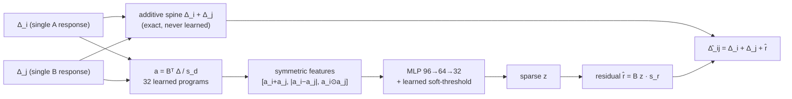

# Lexicon

**A preregistered test of whether a small neural network can learn a reusable "grammar" of how genetic perturbations combine — and an honest record of the answer: not yet.**

## The idea

A language model does not simulate every word interaction; it compresses *reusable transformations* of language into its weights. Lexicon asks whether the same can hold for cells: given the measured response to switching on gene A and gene B separately, can learned weights predict how A+B together **deviates from simple addition** — using composition rules learned from other pairs, not gene identities or pathway databases?

The first test, **L0 (the Syntax Gate)**, uses a public CRISPRa Perturb-seq screen (Norman et al. 2019, GEO [GSE133344](https://www.ncbi.nlm.nih.gov/geo/query/acc.cgi?acc=GSE133344): 105 single-gene and 131 two-gene perturbations in K562 cells). The model **cannot win by relearning addition**: the additive prediction is computed exactly and only the residual is learned.

What makes it worth reading is the method more than the model:

- **Predeclared protocol.** Data, folds, model, loss, baselines, metrics and every gate threshold are written down in [`SPEC.md`](SPEC.md) before the evaluator sees a held-out pair.
- **The verdict comes from code.** [`lexicon/gate.py`](lexicon/gate.py) returns exactly one of `PASS` / `FAIL` / `INDETERMINATE`; it raises rather than return anything else, and the evaluator's exit code is the verdict.
- **Planted controls before real data.** A synthetic world where a composition rule provably exists (positive control) and one where pairing is shuffled (negative control). The positive control caught a real optimisation bug in v1.0 (the orthogonality penalty was ~17× the fit term, so the model never fit the interaction). Without it, a FAIL on real data would have been uninterpretable.
- **Adversarial baselines.** `gene_marginal` catches a model that only learns "gene X is interaction-prone"; `pca_ridge` asks whether learned sparse programs beat plain low-rank regression.

## Architecture



168,320 parameters (5,000 genes × 32 programs + a small MLP). No gene-ID embeddings, pathway annotations or text features: a gene is represented only by its measured single-perturbation response. Training is 5-fold cross-fitting over the 131 pairs (hash-assigned folds), five seeds ensembled per fold.

## Result: INDETERMINATE (and the honest reading is closer to a null)

Canonical run `l0-v1`, committed as [`runs/l0-v1/results.json`](runs/l0-v1/results.json) (all numbers below come from that file).

| Metric (131 held-out pairs) | Lexicon | 95% CI (cluster bootstrap) |
|---|---|---|
| Error reduction vs additive on the 29 high-interaction pairs (`I_high`) | 0.226 | 0.170 – 0.391 |
| Change in error on the 102 near-additive pairs (`D_add`, lower is better) | −0.173 | −0.220 – −0.121 |
| Pair discrimination (0.5 = chance) | 0.707 | Δ vs additive 0.167 – 0.251 |

Every scientific pass condition was met. **The gate still refused a PASS**: dropping gemgroup 3 or 4 of the eight replicates changes the high-interaction set enough that retention falls to 0.897, under the predeclared 0.90 stability bar. The spec says no re-run may convert INDETERMINATE into PASS, so none was attempted.

The more important finding is in the baselines:

| On the high-interaction pairs | Lexicon | PCA-32 + ridge | Gene-marginal |
|---|---|---|---|
| `I_high` | 0.226 | **0.353** | — |
| Discrimination | 0.707 | **0.758** | — |
| Median pair error | 0.00288 | 0.00260 | **0.00243** |

Neither baseline's advantage is statistically resolved (95% CI of Lexicon/baseline error ratio: PCA-ridge 0.91–1.30, gene-marginal 0.98–1.36), but both point estimates favour the simpler model. PCA-ridge uses fixed sum/difference/product features of the two single responses, so it is itself a compositional model with a fixed basis.

**What this supports:** the double-perturbation responses carry substantial, cross-validated predictable structure beyond addition.
**What it does not support:** that a *learned* sparse program basis is needed to capture it, or that the structure is pairwise "grammar" rather than per-gene propensity. Lexicon's specific architectural thesis did not earn the name.

### Limitations

- One assay, one cell line, 131 pairs. The effective sample size is pairs, not cells or gemgroups.
- The predeclared PCA-ridge alpha grid topped out (alpha = 100 chosen in every fold), so that baseline may be under-regularised and stronger than shown.
- The "spec frozen before the run" ordering was enforced in the original private history. This public repository is a fresh snapshot, so that ordering cannot be checked from its git log.
- SPEC §6 lists several items to freeze that were never actually frozen: the GEO file SHA-256 hashes, the HVG gene-list hash, package versions/hardware and result-file hashes. None are recorded in this repo. The fold assignment is fixed by code (a salted SHA-256 sort in `lexicon/split.py`), but no fold manifest file was saved; `results.json` records fold sizes only. `scripts/download_gse133344.sh` writes a `SHA256SUMS` for your own download and `lexicon.data` computes a `gene_list_sha256`, but nothing compares either to a reference value. `Manifest.check()` verifies only the predeclared counts (genes, cells, singles, pairs, gemgroups) and the pair-completeness checks.
- `controls/*.json` were produced by the original code. This snapshot differs only in comments, docstrings and a small CLI added to `lexicon/data.py`, so the `source_sha256` stored in those bundles will not match these files.
- Reproducing `l0-v1` exactly needs the same hardware/software stack; GPU training is not bit-deterministic across platforms.

## Quickstart

No API keys, accounts or environment variables are needed.

```bash
python -m venv .venv && source .venv/bin/activate
pip install -e ".[dev]"

pytest -m "not slow"     # parser, folds, model invariants, metrics, gate logic (seconds)
pytest                   # + planted controls and an end-to-end evaluator run (~6 min on 2 CPU cores)

# the 8-condition planted-control suite on its own
python -m lexicon.controls --device cpu --out runs/controls-cpu.json
```

### Running L0 on the real data

Needs about 1.1 GB of download and 16–32 GB of RAM for preprocessing; training itself is small (a consumer GPU finishes in under 2 minutes, CPU works but is slower).

```bash
pip install -e ".[data]"                          # scanpy, anndata, scikit-misc
scripts/download_gse133344.sh data/raw            # four GEO files + SHA256SUMS
python -m lexicon.data --raw data/raw --out data/proc   # exit 0 only if the manifest matches SPEC §1

# run the controls on the backend you will use, then the one-shot gate
python -m lexicon.controls --device cuda --out runs/controls-gpu.json
python -m lexicon.run_l0 --data data/proc --out runs/my-run
echo $?    # 0 PASS, 1 FAIL, 2 INDETERMINATE, 3 INVALID (manifest breach)
```

`--device cuda` also covers ROCm builds of PyTorch.

## Repository map

```
SPEC.md               predeclared protocol (L0 v1.0) + 11 v1.1 amendments, each triggered
                      by a planted control failing, never by a biological result
lexicon/data.py       GEO files -> condition x gemgroup pseudobulk + manifest contract
lexicon/split.py      hash-based folds; interaction strata thresholds from training pairs only
lexicon/model.py      the 168,320-parameter model over an exact additive spine
lexicon/baselines.py  five baselines; additive singles is the thesis null
lexicon/metrics.py    pair error, discrimination, stratified cluster bootstrap, stability
lexicon/gate.py       mechanical PASS / FAIL / INDETERMINATE
lexicon/controls.py   the 8 planted-control conditions
lexicon/run_l0.py     one-shot evaluator; exit code is the verdict
controls/             reference control bundles (CPU and ROCm GPU, all 8 conditions pass)
runs/l0-v1/           reference run: results.json (per-pair table) and programs.json
                      (post-gate program read-out, never used in scoring)
scripts/              data download helper
tests/                synthetic tests; no network, no data download
```

## Status

**Research experiment, inactive.** L0 ran once, as specified. The natural next steps, written down but not built, are: (1) a new gate that scores interaction strength continuously and estimates it from disjoint gemgroups, so stratum instability cannot block it; (2) a leave-anchor-gene-out test that centres out per-gene propensity, which is the direct test of "pairwise grammar vs gene-marginal"; on this dataset it would be exploratory, since its outcomes have been seen, and confirmation would need an untouched combinatorial screen.

## How it was built

Designed by Nick McBride and built with his AI agent Iris (Claude-based) as part of a personal research platform. A second LLM from a different model family served as adversarial reviewer of the protocol.

## License

MIT, see [LICENSE](LICENSE). The GSE133344 data are not redistributed here; see the GEO record for its terms and cite Norman et al., *Science* 2019.
